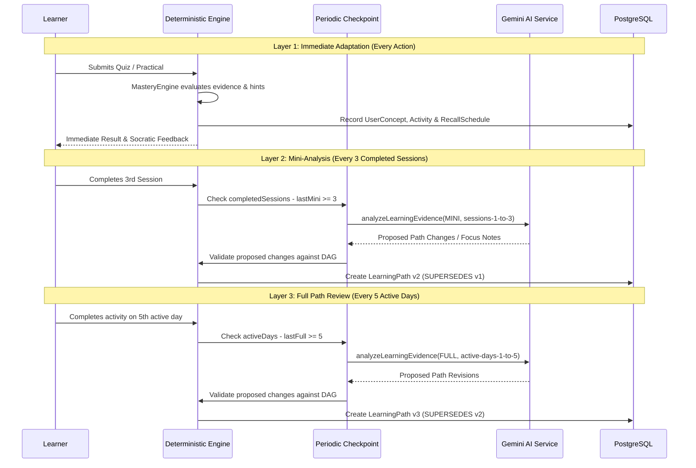

# Adaptive Learning & Gemini AI Platform Architecture

This document describes the upgraded architecture for the **AI Learning Companion for Software Engineers**, detailing the deterministic learning engine, the official Google Gen AI Gemini integration, evidence-driven mastery calculations, the three adaptation layers, path versioning, and privacy controls.

---

## 1. System Architecture: Hybrid Authority Model

The application employs a **hybrid architecture** with strict separation of concerns between deterministic backend authority and probabilistic generative intelligence:

```mermaid
graph TD
    Learner[Learner Activity / Assessments] --> BackendAuth[Deterministic Learning Engine]
    BackendAuth --> DB[(PostgreSQL Database)]
    
    subgraph Deterministic Engine (Source of Truth)
        Mastery[Mastery & Confidence Engine]
        DAG[Prerequisite Graph / Topological Sort]
        Scheduler[Spaced Repetition Scheduler]
        Gatekeeper[Path Validator & Version Manager]
    end
    
    subgraph Gemini AI Service (Advisory & Pedagogical)
        Planner[Initial Path Pedagogical Ordering]
        Synthesizer[Explain-Back Rubric Evaluation]
        Tutor[Socratic Tutor Guidance]
        Reviewer[Periodic Evidence Review: Mini/Full/Long-Term]
    end
    
    BackendAuth --> Mastery
    BackendAuth --> DAG
    BackendAuth --> Scheduler
    
    Gatekeeper -->|Sanitized Evidence Window| Reviewer
    Reviewer -.->|Proposed JSON Changes| Gatekeeper
    Gatekeeper -->|Validate against DAG & DB| DB
```

### Architectural Responsibilities:

1. **Deterministic Learning Engine (Backend - Source of Truth):**
   - Authoritative tracking of learner state, mastery, and confidence scores.
   - Strict prerequisite enforcement (prerequisite readiness threshold $\ge 60\%$).
   - Session telemetry, XP issuance, and streak calculations.
   - Spaced recall scheduling ($1, 2, 3$ day scientifically calibrated intervals).
   - Validation and transactional activation of path versions.
   - Guaranteed deterministic fallback whenever AI models are unconfigured, unreachable, or exceed latency bounds.

2. **Gemini AI Service (`@google/genai`):**
   - Initial path planning: Proposing pedagogically coherent ordering and learner pacing from onboarding signals.
   - Socratic companion guidance: Guiding learners with hints rather than leaking direct solutions.
   - Semantic explain-back evaluation: Scoring conceptual explanations against multi-dimensional rubrics (accuracy, completeness, clarity).
   - Periodic evidence analysis: Reviewing multi-session trends and proposing path adjustments.
   - **Boundary Constraint**: Gemini **never** mutates the database directly, never issues XP, never overrides mastery, and never bypasses prerequisite relationships.

3. **Path Validation and Persistence:**
   - Every proposal generated by Gemini is validated against the live database concepts, published lessons, and prerequisite Directed Acyclic Graph (DAG).
   - If an AI proposal references unknown IDs, duplicates, or broken prerequisite order, it is rejected safely and the deterministic candidate sequence is activated without blocking the learner.

---

## 2. Gemini API Configuration & Security

The platform integrates the official Google Gen AI SDK (`@google/genai` v2.30.0).

### Environment Variables
Configure the following in `apps/backend/.env`:

| Variable | Description | Default |
| :--- | :--- | :--- |
| `GEMINI_API_KEY` | Secret API key for Google Gemini API | `your-gemini-api-key-here` |
| `GEMINI_MODEL` | Gemini model name for generation & analysis | `gemini-2.5-flash` |
| `GEMINI_TIMEOUT_MS` | Bounded timeout for AI calls (milliseconds) | `15000` |
| `AI_PROVIDER` | AI provider flag | `gemini` |

### Security & Privacy Protections:
- **Backend-Only Exposure**: `GEMINI_API_KEY` is strictly confined to `apps/backend/src/config/index.js` and never exposed to the frontend browser bundle.
- **Data Minimization**: Prompts only transmit anonymized learning telemetry (concept names, duration, hint counts, misconception strings). No passwords, hashes, email addresses, or personally identifiable information are sent.
- **Fail-Safe Operation**: If `GEMINI_API_KEY` is missing or invalid, all learner operations (onboarding, daily sessions, quizzes, recommendations, streak) continue operating smoothly using deterministic fallbacks.

---

## 3. Evidence-Driven Learner State & Mastery Rules

The platform replaces arbitrary $+25/-10$ mastery jumps with the evidence-driven `MasteryEngine` (`apps/backend/src/modules/learner-model/mastery-engine.js`).

### Core Rules:
1. **Multi-Session Mastery Verification**: A learner cannot achieve Mastered ($\ge 75\%$) on a single quiz pass.
   - Attempt 1 (Unassisted Pass): Mastery capped at $45\%$ ($+20\%$ delta).
   - Attempt 2 (Unassisted Pass): Mastery capped at $70\%$ ($+20\%$ delta).
   - Attempt 3+ (Unassisted Pass): Mastery eligible for $100\%$.
2. **Hint Assistance Discounting**:
   - Unassisted pass ($0$ hints): Full $+20\%$ mastery gain.
   - Hint-assisted pass ($\ge 1$ hints): Discounted $+10\%$ mastery gain, strictly capped at Competent ($\le 60\%$).
3. **Graceful Failure Penalty**:
   - Failing an assessment decrements mastery by $10\%$ and schedules rapid review for tomorrow ($1$ day), but **never zeroes out historical progress**.
4. **Confidence Score Scaling**:
   - Confidence reflects evidence volume and consistency: `(attempts * 15) + (independentSuccesses * 20) - failurePenalty`.
5. **Delayed Spaced Recall**:
   - Rating $4-5$ (Strong retention): $+6\%$ mastery, confidence boost.
   - Rating $1-2$ (Forgotten/Struggle): $-6\%$ mastery, rescheduled for tomorrow.
6. **Explain-Back Synthesis**:
   - Evaluated across accuracy ($40\%$), completeness ($35\%$), and clarity ($25\%$), blended smoothly into concept mastery while penalizing conceptual misconceptions.

---

## 4. Three Layers of Adaptation



### Layer 1: Immediate Adaptation (Per Activity)
- Evaluated deterministically after every quiz, lesson, or recall submission.
- Selects among four actions:
  - `ADVANCE`: Prerequisites satisfied, moves forward.
  - `REINFORCE`: Low mastery or recent failure detected; schedules targeted practice.
  - `REVIEW`: Spaced repetition recall interval due.
  - `PREREQUISITE`: Knowledge gap detected before attempting dependent concept.
- If a concept has no published lesson, returns recoverable `CONTENT_UNAVAILABLE` rather than silently substituting random lessons.

### Layer 2: Mini-Analysis (Every 3 Completed Sessions)
- Trigger condition: `completedSessionsCount - profile.lastMiniAnalysisSessionCount >= 3`.
- Inspects recent hint usage, quiz accuracy, and misconception tags.
- Identifies whether the learner is struggling independently or relying excessively on hints.
- Persists checkpoint on `UserProfile` so the same sessions do not re-trigger.

### Layer 3: Full Path Review (Every 5 Active Days) & Long-Term Review (10 Days)
- Trigger condition: `activeDaysCount - profile.lastFullReviewActiveDays >= 5`.
- Evaluates distinct active learning days (inactive calendar days are excluded).
- Evaluates progress toward target role, skill retention, and difficulty calibration.
- Ten-day review triggers at `activeDaysCount - profile.lastLongTermActiveDays >= 10` for broad goal alignment.

---

## 5. Path Versioning, Persistence, and Idempotency

Path updates follow strict versioning in `LearningPath`:
- `version`: Sequential integer (`1, 2, 3...`).
- `previousPathId`: Foreign key reference to the superseded path.
- `analysisType`: `'INITIAL'`, `'MINI'`, `'FULL'`, `'LONG_TERM'`.
- `triggerReason`: Explaining why the path changed (e.g. `PERIODIC_CHECKPOINT_MINI`).
- `evidenceSummary`: JSON snapshot of findings and confidence score.
- `confidence`: Confidence rating (`0.0` to `1.0`).
- **Auditability**: Historical paths are marked `SUPERSEDED`, never destructively overwritten or deleted.

---

## 6. Protection of Learner Experience & Roadmap Privacy

In accordance with product guidelines, the learner must only see today's learning experience:
- **Learner Views (`/today`, `/my-learning`)**: Display today's objective, the current session, completed concepts, and practice recommendations.
- **API Guard (`GET /api/v1/learning-paths/current`)**:
  - For standard learners: Filters `items` to return only `COMPLETED` concepts and the single active `IN_PROGRESS` milestone. Future `PENDING` concepts are completely hidden.
  - For staff/administrators (`role: 'ADMIN'`): Returns the entire roadmap graph for curriculum analysis.

---

## 7. Database Migrations

Forward-only schema migration applied via Prisma:
- **Migration Name**: `20261017053825_add_gemini_adaptive_state`
- **Tables Updated**:
  - `user_profiles`: Added `lastMiniAnalysisSessionCount`, `lastFullReviewActiveDays`, `lastLongTermActiveDays`.
  - `user_concepts`: Added `hintsCount`, `independentSuccesses`, `assistedSuccesses`, composite index `[userId, masteryScore]`.
  - `learning_paths`: Added `version`, `previousPathId`, `analysisType`, `triggerReason`, `evidenceSummary`, `confidence`.
  - `learning_sessions`: Added `hintsUsed`, `initialMastery`, `finalMastery`, `quizAttemptId`, `explainAttemptId`, indexes on `[userId, status]` and `[userId, lessonId, status]`.

---

## 8. Test Execution & Verified Results

Run backend test suite:
```bash
npm --prefix apps/backend test
```

### Verified Test Summary:
- **Total Test Suites**: `7 passed (7)`
- **Total Tests**: `41 passed (41)`
- **Breakdown**:
  - `tests/gemini.test.js`: 7 passed (Mock fallback, rubric fallback, structured analysis, DAG validation, unknown concept rejection, invalid order rejection, timeout handling).
  - `tests/mastery.test.js`: 7 passed (Single pass ceiling, hint discounting, failure history preservation, recall reinforcement/penalty, explain-back synthesis, boundary clamping).
  - `tests/adaptation-layers.test.js`: 8 passed (Layer 1 ADVANCE & PREREQUISITE, Layer 2 3-session mini-analysis, Layer 3 5-day active review, path versioning, roadmap privacy, admin view, content unavailable recovery).
  - `tests/engine.test.js`: 7 passed (Onboarding, assessment grading, roadmap generation, recommendations, quiz/XP idempotency, recall, admin security).
  - `tests/adaptive.test.js`: 6 passed (Rule hierarchy, spaced recall priority, weakness reinforcement, time adaptation).
  - `tests/auth.test.js`: 5 passed (Signup, duplicate rejection, signin, token authentication, unauthenticated rejection).
  - `tests/health.test.js`: 1 passed (Health status check).

Frontend verification:
```bash
npm --prefix apps/frontend run build
```
- **Result**: `17/17` static and dynamic pages compiled and built successfully with zero type or build errors.
