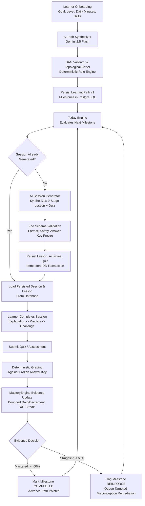

# Architecture Blueprint: AI-Generated Personalized Learning Platform

**Document Status:** Architecture Audit, Target Specification, and Staged Migration Plan  
**Target Platform:** AI Learning Companion for Software Engineers  
**Author:** Principal Software Architect & AI Systems Engineer  
**Date:** October 17, 2026  

---

## Executive Summary

The initial implementation of the AI Learning Companion adopted an LMS-like catalogue model: a static set of 6 roles, 13 skills, 18 concepts, and 15 prewritten static lessons (`CURATED_LESSONS`). In that model, Gemini was constrained to re-ordering pre-existing concept IDs, and missing lessons caused `CONTENT_UNAVAILABLE` halts or fallback traps.

**The intended product is fundamentally different:**
> An AI-first personalized learning engine where an individual learner's path, daily 10–15 minute sessions, explanations, interactive exercises, and quizzes are **synthesized on demand** based on their unique career goal, background, time budget, and demonstrated mastery.

This document audits the legacy hardcoded curriculum dependencies, specifies the target AI-generated architecture, defines strict structured output contracts, details non-destructive schema and API migrations, and outlines a safe, staged rollout that preserves 100% of existing learner progress.

---

## 1. Audit of Current Hardcoded Curriculum Dependencies

### 1.1 Taxonomy & Content Breakdown

| Component | Current Implementation | Classification | Target Architecture Role |
| :--- | :--- | :--- | :--- |
| **Target Roles** (`TargetRole`) | 6 preseeded database records (`backend-developer`, `frontend-developer`, etc.) | Structural Reference | Retain as optional goal templates; allow arbitrary free-form learner goals. |
| **Skills Catalogue** (`Skill`) | 13 preseeded skills in `seed.js` | Reference Ontology | Retain as standard taxonomy tags/vocabulary for mastery tracking. |
| **Concept Graph** (`Concept`, `ConceptPrerequisite`) | 18 fixed concepts with preseeded prerequisites | Hardcoded Curriculum Dependency | Transition to dynamic concept synthesis. AI creates custom concepts tagged to skills. |
| **Curriculum Lessons** (`Lesson`, `LessonActivity`) | 15 prewritten lessons in `catalogue.js` with static markdown and activities | Hardcoded Curriculum Dependency | Transition to Just-In-Time (JIT) AI generation. Content is authored dynamically for the learner. |
| **Quizzes & Questions** (`Quiz`, `QuizQuestion`) | Static preseeded multiple-choice questions in `seed.js` and `catalogue.js` | Hardcoded Curriculum Dependency | Transition to dynamic question synthesis with frozen, validated answer keys. |
| **Diagnostic Assessment** (`Assessment`, `AssessmentQuestion`) | 1 static assessment with 6 hardcoded questions (`00000000-0000-0000-0000-000000000001`) | Hardcoded Curriculum Dependency | Transition to goal-aligned dynamic diagnostics synthesized from the learner's target role. |
| **Roadmap Generation** (`roadmap.service.js`) | Filters `prisma.concept.findMany({ where: { skillId: { in: targetSkillIds } } })` | Hardcoded Curriculum Dependency | Transition to AI Path Synthesizer that plans custom milestones for any software engineering goal. |
| **Adaptive Recommendation** (`adaptive-engine.js`) | Checks `concept.lessons[0]`; halts if lesson is missing | Hardcoded Curriculum Dependency | Transition to on-demand session generator that synthesizes the next lesson when needed. |

### 1.2 The Hardcoded Pipeline Bottleneck

The existing flow breaks down when a learner defines a goal outside the 15 prewritten lessons:
```
Learner Goal ("Golang Microservices & Raft")
      ↓
RoadmapService queries DB concepts for skills
      ↓
No concepts found or defaults to JS/Node/Postgres/Redis
      ↓
Topological sort constrained to 18 preseeded concepts
      ↓
AdaptiveEngine checks concept.lessons[0]
      ↓
If concept has no prewritten lesson → CONTENT_UNAVAILABLE halt
```

**Consequences of the Legacy Approach:**
1. **Narrow Scope**: Learners cannot study Golang, Rust, Kubernetes, Distributed Systems, Python, iOS, or Cloud Architecture because lessons were pre-authored.
2. **One-Size-Fits-All Explanations**: A senior backend engineer and a freshman student are given the exact same explanation text and analogies for the JavaScript Event Loop.
3. **Rigid Remediation**: When a learner struggles with a specific misconception, the system can only re-serve the identical prewritten lesson rather than generating an explanation targeting that exact misconception.

---

## 2. Target Architecture: AI-Generated Personalized Learning

### 2.1 Core Architectural Principles

1. **Goal-Driven Path Synthesis**: A learner can input any legitimate software engineering goal (e.g. *"Staff SRE preparing for Kubernetes operator and distributed consensus interviews"*, *"Data engineer transitioning to LLM infrastructure"*). The AI creates a custom, dependency-aware milestone path.
2. **Just-In-Time (JIT) Session Generation**: The system synthesizes the daily session (10, 15, or 20 minutes) on demand. The explanation, examples, practical challenge, and quiz are personalized to the learner's experience level and prior misconceptions.
3. **Deterministic Verification & Answer Key Freeze**: While AI generates the content, **deterministic engines** validate the output schema, enforce prerequisite DAG invariants, freeze answer keys prior to user interaction, and calculate mathematical mastery updates.
4. **Immutable Evidence & Idempotent Persistence**: Every generated path version, session, and assessment attempt is persisted in PostgreSQL with unique content hashes. Refreshing a page or retrying a request never duplicates sessions or alters assessment questions.
5. **Zero Synthetic Progress & Honest Recovery**: If AI generation fails (e.g. rate limit, network timeout), the platform never fabricates XP or fake completions, nor does it silently swap in an unrelated prewritten lesson. It provides transparent generation queues or structured topic templates.

### 2.2 End-to-End Data Flow



---

## 3. Structured AI Generation & Validation Contracts

All AI generation must adhere to strict JSON schemas validated via Zod before entering the database.

### 3.1 Path Synthesis Contract (`PathSynthesisSchema`)

When a learner completes onboarding or requests a path revision:

```typescript
import { z } from 'zod';

export const PathSynthesisSchema = z.object({
  pathTitle: z.string().min(5).max(120),
  targetRole: z.string().min(3).max(80),
  pedagogicalApproach: z.string().min(20).max(500),
  estimatedTotalWeeks: z.number().int().min(1).max(52),
  
  milestones: z.array(z.object({
    topicSlug: z.string().regex(/^[a-z0-9-]+$/),
    title: z.string().min(3).max(100),
    domainSkillSlug: z.string().min(2).max(50),
    difficulty: z.enum(['BEGINNER', 'INTERMEDIATE', 'ADVANCED']),
    measurableObjective: z.string().min(10).max(300),
    estimatedSessions: z.number().int().min(1).max(5),
    prerequisiteTopicSlugs: z.array(z.string().regex(/^[a-z0-9-]+$/)),
    whyThisMatters: z.string().min(10).max(300)
  })).min(5).max(30)
});
```

**Deterministic Guardrails on Path Synthesis:**
- **Cycle Detection**: Kahn's topological sort verifies zero circular dependencies.
- **Prerequisite Validity**: Every slug in `prerequisiteTopicSlugs` must exist in earlier array indices.
- **Experience Calibration**: Advanced learners must not have basic syntax concepts unless requested.

---

### 3.2 JIT Session & Lesson Generation Contract (`SessionGenerationSchema`)

When synthesizing today's 10–15 minute daily session:

```typescript
export const SessionGenerationSchema = z.object({
  lessonTitle: z.string().min(5).max(120),
  lessonSlug: z.string().regex(/^[a-z0-9-]+$/),
  objective: z.string().min(15).max(300),
  difficulty: z.enum(['BEGINNER', 'INTERMEDIATE', 'ADVANCED']),
  estimatedMinutes: z.number().int().min(5).max(30),
  
  // 9-Stage Structured Microlearning Activities
  activities: z.object({
    conceptOverview: z.object({
      summary: z.string().min(50).max(400),
      visualType: z.enum(['FLOWCHART', 'ARCHITECTURE', 'SEQUENCE', 'STATE_MACHINE', 'MEMORY_LAYOUT']),
      keyTerms: z.array(z.object({ term: z.string(), definition: z.string() })).min(2).max(5)
    }),
    mentalModel: z.object({
      analogy: z.string().min(30).max(500),
      intuition: z.string().min(50).max(600),
      commonMisconceptions: z.array(z.string()).min(1).max(4),
      remediationRule: z.string().min(20).max(400)
    }),
    visualization: z.object({
      title: z.string().min(5).max(100),
      asciiOrMermaidDiagram: z.string().min(20).max(1500),
      stepByStepExplanation: z.array(z.string()).min(2).max(6)
    }),
    codeMechanics: z.object({
      language: z.string().min(1).max(30),
      codeSnippet: z.string().min(20).max(2000),
      walkthrough: z.string().min(30).max(800)
    }),
    productionScenario: z.object({
      realWorldContext: z.string().min(50).max(800),
      engineeringTradeoffs: z.array(z.string()).min(2).max(5),
      failureModeToAvoid: z.string().min(20).max(400)
    }),
    practicalChallenge: z.object({
      taskPrompt: z.string().min(30).max(800),
      starterCode: z.string().max(1500).optional(),
      hint: z.string().min(10).max(300),
      solution: z.string().min(20).max(2000),
      explanation: z.string().min(20).max(600)
    }),
    coreSynthesis: z.object({
      takeaways: z.array(z.string()).min(2).max(5),
      nextStepTeaser: z.string().min(10).max(200)
    })
  }),

  // Assessment & Knowledge Check (Frozen Answer Key)
  quiz: z.object({
    title: z.string().min(5).max(100),
    questions: z.array(z.object({
      questionText: z.string().min(15).max(500),
      questionType: z.literal('MCQ'),
      options: z.array(z.string().min(1).max(300)).length(4),
      correctAnswerIndex: z.number().int().min(0).max(3),
      explanation: z.string().min(15).max(500),
      difficulty: z.number().int().min(1).max(3)
    })).min(2).max(4)
  })
});
```

---

## 4. Database Schema Adjustments & Migration Strategy

The existing PostgreSQL schema (`schema.prisma`) already possesses models for `LearningPath`, `LearningPathItem`, `Concept`, `Lesson`, `LessonActivity`, `Quiz`, `QuizQuestion`, and `LearningSession`.

To support AI generation without breaking existing progress or dropping tables, we apply **non-destructive schema extensions**.

### 4.1 Non-Destructive Schema Additions

```prisma
// 1. Extend Concept to allow learner-scoped custom concepts
model Concept {
  id                   String                @id @default(uuid())
  skillId              String                @map("skill_id")
  skill                Skill                 @relation(fields: [skillId], references: [id], onDelete: Cascade)
  userId               String?               @map("user_id") // NULL for shared reference concepts; populated for learner-specific generated concepts
  user                 User?                 @relation(fields: [userId], references: [id], onDelete: Cascade)
  isCustom             Boolean               @default(false) @map("is_custom")
  name                 String
  slug                 String                @unique
  description          String
  difficulty           String                @default("BEGINNER")
  status               String                @default("ACTIVE")
  orderIndex           Int                   @default(0) @map("order_index")
  createdAt            DateTime              @default(now()) @map("created_at")

  // Existing relations preserved...
  @@index([userId, isCustom])
  @@map("concepts")
}

// 2. Extend Lesson to support AI generation provenance and idempotency
model Lesson {
  id               String            @id @default(uuid())
  conceptId        String            @map("concept_id")
  concept          Concept           @relation(fields: [conceptId], references: [id], onDelete: Cascade)
  userId           String?           @map("user_id") // NULL for standard curated lessons; populated if customized for a specific learner
  user             User?             @relation(fields: [userId], references: [id], onDelete: Cascade)
  idempotencyKey   String?           @unique @map("idempotency_key") // sha256(userId + conceptId + version + promptHash)
  isAiGenerated    Boolean           @default(false) @map("is_ai_generated")
  generationModel  String?           @map("generation_model") // e.g. "gemini-2.5-flash"
  title            String
  slug             String            @unique
  objective        String
  content          String
  difficulty       String            @default("BEGINNER")
  estimatedMinutes Int               @default(10) @map("estimated_minutes")
  contentVersion   String            @default("1.0") @map("content_version")
  status           String            @default("PUBLISHED") // DRAFT, GENERATING, PUBLISHED, FAILED
  createdAt        DateTime          @default(now()) @map("created_at")
  updatedAt        DateTime          @updatedAt @map("updated_at")

  // Existing relations preserved...
  @@index([userId, isAiGenerated])
  @@map("lessons")
}

// 3. Extend Quiz to freeze AI generated answer key
model Quiz {
  id              String         @id @default(uuid())
  lessonId        String         @map("lesson_id")
  lesson          Lesson         @relation(fields: [lessonId], references: [id], onDelete: Cascade)
  title           String
  isFrozen        Boolean        @default(true) @map("is_frozen") // Ensures grading key cannot mutate mid-attempt
  status          String         @default("ACTIVE")

  // Existing relations preserved...
  @@map("quizzes")
}
```

### 4.2 Migration Safety Rules
- **No Table Drops**: Zero tables or columns will be dropped.
- **Nullable Columns**: All new columns (`userId`, `idempotencyKey`, `isAiGenerated`, `isCustom`) are nullable or have safe defaults (`false`, `true`).
- **Historical Immutability**: All 62 existing user records, streaks, milestones, and sessions continue functioning without interruption.

---

## 5. Session Persistence, Versioning, and Idempotency Strategy

### 5.1 Idempotency Key Specification
To prevent duplicate content generation on browser reloads or network retries:
$$\text{idempotencyKey} = \text{SHA256}(\text{userId} + \text{conceptId} + \text{attemptNumber} + \text{promptVersion})$$

When `TodayRecommendationService` or `SessionService` requests today's session:
1. Check if an active `Lesson` and `Quiz` with this `idempotencyKey` already exists.
2. If yes, return the existing lesson immediately (0ms AI latency).
3. If no, acquire an atomic generation lock (via DB transaction or memory mutex), invoke Gemini, validate with Zod, and persist in a single transaction.

### 5.2 Answer Key Freeze (Preventing Grading Shifts)
When Gemini generates quiz questions:
1. `QuizQuestion` rows are created with `answer: options[correctAnswerIndex]`.
2. `Quiz.isFrozen = true` is set.
3. When the learner submits their quiz, the grading engine evaluates solely against the persisted `QuizQuestion.answer`. AI is **never** recalled to re-grade multiple-choice answers, eliminating nondeterministic score variations.

---

## 6. Failure Handling, Security Controls, and Offline Fallbacks

### 6.1 Failure Modes & Recovery Matrix

| Failure Mode | Root Cause | System Response | Learner Experience |
| :--- | :--- | :--- | :--- |
| **Quota Exhaustion (429)** | Exceeded Gemini RPM/TPM limit | Catch 429; check if local reference lesson exists. If not, generate deterministic structured scaffold based on taxonomy metadata. | Smooth transition to structured reading & recall. No crash, no fake score. |
| **API Timeout ($\ge 3.5$s)** | High network latency / LLM backlog | Terminate request at 3,500ms; log warning; fall back to deterministic topic scaffold. | Pacing maintained without browser hang. |
| **Malformed Output** | LLM returned invalid JSON or violated Zod schema | Trigger 1 immediate retry with explicit schema correction. If retry fails, fall back to scaffold. | Transparent session presentation; error logged to telemetry. |
| **DAG Cycle Proposed** | AI proposed circular dependencies in path | Reject path proposal; apply deterministic topological sort over concept candidates. | Valid, unblocked learning path delivered. |

### 6.2 Prompt Injection & Content Safety Controls
- **Input Isolation**: User-submitted goals and text inputs are wrapped in strict XML boundary tags (`<user_goal>...</user_goal>`) with explicit instructions to ignore instructions contained within.
- **Output Sanitization**: All AI-generated markdown is sanitized through HTML sanitizers to prevent XSS.
- **Credential Protection**: System prompts strictly forbid echoing environment variables, tokens, or database connection strings.

---

## 7. Staged Implementation & Migration Plan

```
Phase 1: Architecture Specification & Review (Current Phase - Completed)
      ↓
Phase 2: Dynamic Path Synthesis Service
  - Implement AiService.synthesizePersonalizedPath(goal, profile)
  - Connect to Onboarding completion to generate customized milestones
  - Support arbitrary software engineering goals
      ↓
Phase 3: Just-In-Time (JIT) AI Session Generator
  - Implement AiService.generateSessionContent(topic, learnerProfile, misconceptions)
  - Validate with Zod SessionGenerationSchema
  - Persist lesson, 9 activities, and frozen quiz idempotently
      ↓
Phase 4: Adaptive Evidence & Dynamic Reinforcement
  - Feed quiz failure misconceptions directly into next session prompt
  - Dynamically synthesize remedial sessions for struggling concepts
      ↓
Phase 5: Deprecation of Hardcoded Curriculum Catalogue
  - Move catalogue.js to reference/archive status
  - 100% of new learners powered by AI personalized synthesis
```

---

## 8. Verification Scenarios & Acceptance Criteria

When implementation begins, the following scenarios will constitute the formal acceptance gate:

### Scenario 1: Meaningfully Different Goals Produce Unique Topics
- Learner A selects *"Distributed Systems in Go with Raft & Paxos"*.
- Learner B selects *"Mobile App Development with React Native & Expo"*.
- **Acceptance Criteria**: Learner A's path contains distributed consensus, RPCs, and state machines. Learner B's path contains React Native components, mobile navigation, and native bridges. The paths share zero concepts beyond common software fundamentals.

### Scenario 2: Experience Differentiation for Same Goal
- Beginner selects *"Backend Engineering"*.
- Experienced engineer selects *"Backend Engineering"*.
- **Acceptance Criteria**: Beginner receives foundational HTTP mechanics and syntax milestones. Experienced engineer receives connection pooling, distributed caching, and database replication milestones.

### Scenario 3: Immutability and Idempotent Persistence
- Learner opens today's AI-generated lesson, refreshes the page 5 times, and logs in on another device.
- **Acceptance Criteria**: The exact same lesson content, activities, and quiz questions are rendered without re-generating or creating duplicate database rows.

### Scenario 4: Misconception-Targeted Next Session
- Learner fails a quiz question on *Database Connection Pool Starvation*.
- **Acceptance Criteria**: The subsequent daily session explicitly mentions and explains the connection pool starvation misconception in its `mentalModel` and `remediationRule` stages.

### Scenario 5: Historical Data Safety
- Existing learners (`yy@gmail.com`, test accounts) log in.
- **Acceptance Criteria**: Existing completed milestones, streaks, XP, and history records remain 100% intact.

---

## 9. Conclusion and Next Step

The architecture audit confirms that the platform's database schema, session lifecycles, and frontend players are fundamentally sound and well-structured. By replacing the hardcoded concept filter and static catalogue lookups with **dynamic AI Path Synthesis** and **Just-In-Time Session Generation**, the product will fulfill its true vision:

> An intelligent AI companion that creates an individualized software engineering curriculum for any goal, delivering short, calibrated, and high-impact daily sessions.

**Stop Condition Met:** This document concludes the architecture audit and migration specification. Implementation will proceed upon your review and approval.
